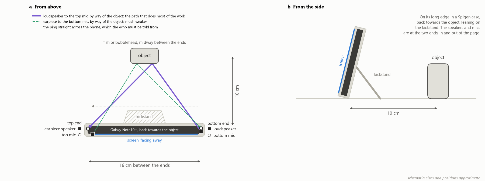

# Phone sonar

A Samsung Galaxy Note10+ used as an active sonar in air. It pings above hearing from its own speakers,
listens with its own microphones, and a small model running on the phone says which of two objects
is standing in front of it: a 3D-printed fish or a bobblehead.



It is a deliberately small version of the problem a handheld search sonar solves: say what a target
is from its echo, on the device, from data collected in the field. Most of the work went into
finding out what the signal contains, and what could be fooling the model.


*What each object added to the empty scene, one line per set, on each speaker-to-mic path. Between
the dashed lines, on the two paths that cross the phone, the fish (blue) and the bobblehead (orange)
separate; that stretch is what the model is given. The grey band is the empty scene against itself:
what is left when nothing has changed.*

## In brief

- **Data.** 26 sets, each an empty scene, the fish and the bobblehead recorded in one spot: 52
  labelled object recordings, 1,248 examples of 0.4 s. The phone labels its own data, blind. One
  further set is left out because its labels appear to be swapped.
- **Result.** With each set held out in turn, a small CNN names 47 of the 52 recordings and a
  nearest-class-mean baseline 46. At this sample size the CNN is not shown to add anything.
- **Generalisation.** The first model named 16 of 16 in development and 9 of 12 on new sets in the
  field; the cause was found and the input changed. The model built on that input then met 11 new
  sets two weeks later, on the phone, blind: 18 of 22.
- **Known weaknesses.** The input carries the object's distance as well as its shape, and the field
  misses show it: they are the recordings whose echo arrived earlier or later than usual. 26 sets is
  a small sample.
- **On the phone.** A 48 KB ExecuTorch model and the signal chain in Java. Replayed on a PC, the
  app's code gives the same answer as the Python pipeline for all 52 recordings.
- **Scope.** Two hard objects in air, 10 cm away and always present: it classifies, it does not
  detect or locate. Hard objects in air echo strongly from their surface; a body in water echoes
  weakly and variably, mainly from the air inside it, and nothing here measures that
  ([why](docs/details.md#limits)).
- **Next.** Sets recorded at measured distances, and an input without timing, which on these data
  holds up across distance at little cost at 10 cm.

## Data and evaluation

A Galaxy Note10+ stands on its long edge with the object 10 cm in front. Each end has a speaker and a
mic, 16 cm apart; the model uses the two crossing paths, each speaker to the mic at the far end.
Every test holds out whole sets, because a recording's examples are near-duplicates.

Set 200754 is left out: its labels look swapped, which one mis-tap in the app would do, but that
cannot be confirmed ([details](docs/details.md#the-second-field-test)).

## Results

Recordings named correctly:

| Test | CNN | Nearest class mean |
|---|---|---|
| Each of the 26 sets held out in turn | 47 of 52 | 46 of 52 |
| Trained on the 15 sets up to 13 October, tested on the 11 from 27 October | 18 of 22 | 16 of 22 |
| Control: both objects' echoes made equally loud | 44 of 52 | 45 of 52 |


*Every recording's P(fish). Diamonds: the phone's answer at the time (red: wrong). Bars: the 15-set
model on the PC. Shaded: the 11 sets recorded after it was built, where phone and PC agree on every
recording.*

Most errors are fish named the bobblehead (4 of the CNN's 5 held-out misses). A class mean on one
path names 47 of 52, as many as the CNN, so these data do not make the case for it. The second test
is the fair one: its 11 sets were recorded after the input was chosen.

## What could be fooling it

- **Distance instead of shape.** Nothing in the chain removes when the echo arrived, and that is
  distance: 1 cm moves it 0.046 ms. Imitating a 3 cm move costs the CNN 7 (closer) to 16 (further)
  of 52 recordings, and the field misses are echoes that arrived unusually early or late. Eight
  statistics of the echo's shape, with no timing, hold 44 to 49 of 52 across the same moves.
- **Loudness.** The fish echoes about 10 dB louder, but equally loud echoes still separate (44 of
  52): the fish's is compact and the bobblehead's spread out (narrower for the fish in 23 of 26 sets).
- **The room changing** after the empty scene, which broke the first model. The input now stops at
  1.3 ms, as late as an object 10 cm away can echo.
- **The phone.** Timing shifts by a fraction of a sample at each start, the level repeats every four
  pings, and the earpiece barely reaches the far mic. Each was measured and handled.

## How it works


Each speaker chirps from 18 to 22.5 kHz ten times a second, one sweeping up and one down; both mics
record at 48 kHz. Correlating with each chirp turns echoes into peaks against delay. Each ping is
divided by its own direct sound, lined up with the empty scene to a fraction of a sample, averaged in
fours, and the empty scene subtracted. A 1-D CNN of about 9,400 parameters scores 0.2 to 1.3 ms of the
two crossing paths, and the app averages over the recording. On the phone it runs in ExecuTorch
(48 KB) with the signal chain in Java, which agrees with the Python pipeline on all 52 recordings.

## Limits

This exercises a search sonar's pipeline, not its physics. Beyond hard targets in air (above): there is
no beam, so every direction lands in one echo; a real search has no empty scene to subtract; and it
listens while it transmits, which only a separate speaker and mic allow.

## More

[docs/details.md](docs/details.md) has every test with its numbers, both field tests, what the phone
does to the data, the signal chain step by step, the reasoning behind each limit, the next data to
collect and how to build the app. [docs/writeup.md](docs/writeup.md) walks through the figures. To
rerun the tests from the extracted echoes (the raw audio is not included):

```
pip install -r requirements.txt
cd analysis
python classify.py                  # each set held out in turn
python classify.py since 195308     # trained on the 15 sets up to 13 October, tested on the 11 from 27 October
```
