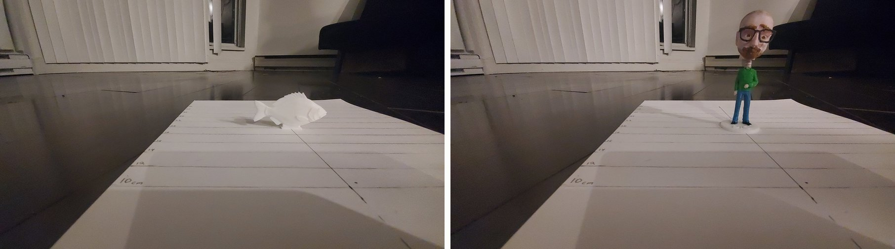

# Phone sonar

A Samsung Galaxy Note10+ used as an active sonar in air. The bottom speaker sweeps up from 18 to 22.5 kHz, the
top speaker sweeps back down, and both mics record the echoes. From those echoes the phone works out, live,
whether anything is in front of it, how far away it is, and which of two objects it is: a 3D-printed fish or a
bobblehead.

## The trial

- **Setup.** The phone stands on a paper mat marked by distance. The app shuffles the positions and says
  which object to place and where. Recordings begin automatically on a delay so the phone isn't touched.
- **Each set.** An empty scene, then both objects at one mark, 10 to 20 cm out. Each block of 7 sets has
  an empty trial, and repeats its first mark at the end to check for drift.
- **Sealed test.** Blocks A to C built the method, always tested on a block it hadn't trained on. Block D
  stayed unopened until the tests and pass marks were [committed](analysis/sealed.py).

*Both objects at the 20 cm mark, photographed by the phone after each recording.*

## The sealed result

| Test on block D | Pass mark | Result | |
|---|---|---|---|
| Correct object named | 12 of 14 | 14 of 14 | Pass |
| Distance within 2 cm | 13 of 14 | 11 of 14 | **Missed** |
| Object detected | 13 of 14 | 14 of 14 | Pass |
| Empty mat reported as empty | 1 of 1 | 1 of 1 | Pass |
| Same answer at 2.8 s as at 10 s | 13 of 14 | 14 of 14 | Pass |
| App matches Python | Same answers, P(fish) gaps of at most 0.05 | Same answers, one gap of 0.0545 | **Missed** |

All three distance misses are the bobblehead at 10 to 14 cm, the weak spot blocks A to C had already shown.
One read 20.2 cm at the 10 cm mark. The other 11 are within 1.1 cm. The app gave every answer Python did; its
miss is one probability gap against a mark set too tight, and it stands. Nothing was retuned afterwards. With
14 recordings, 14 of 14 only shows accuracy above about 77%.

| Error | Blocks A to C, each held out | Block D, sealed |
|---|---|---|
| Object not detected | 1 of 42 | 0 of 14 |
| Empty mat taken for an object | 0 of 3 | 0 of 1 |
| Incorrect object named | 0 of 42 | 0 of 14 |
| Distance off by more than 2 cm | 4 of 42 | 3 of 14 |

Trained on blocks A to C alone, it also names 49 of 52 recordings from earlier sets on other days.

*Blocks A to C. Left: distance read from the echo, not knowing the object. Right: how loud each echo is.*

## Limitations

- **Strength, not shape.** It names the objects mostly by how strongly they reflect. Strength and delay alone
  name 38 of 42, and removing loudness drops the model to 31.
- **Too little bandwidth.** Range resolution is set by bandwidth, c/2B
  ([Klauder et al., 1960](https://archive.org/details/bstj39-4-745)). The speakers deliver about 2.5 kHz, and
  each echo spans about 5 cm. Both objects are smaller than that, so their echoes are no wider than the ping.
  More data won't fix this; more bandwidth might.
- **The bobblehead up close.** Its echo is weak at 10 to 14 cm, and the error can repeat: one mark placed twice
  read 16.7 and 16.6 cm at 14. The echo holds steady from ping to ping, so it isn't moving. The cause is unknown.

## The next trials

1. **The bobblehead at 10 to 14 cm, at measured angles.** Why does the echo fall apart there?
2. **A wider chirp, about 10 to 22 kHz.** Does shape become readable, and how audible is it?
3. **A third object.** The model has no answer for "something else".

## How it works

1. **Make profiles.** Correlating each mic with each chirp turns echoes into peaks against delay. Each ping is
   divided by its own direct sound, which cancels drift.
2. **Isolate the echo.** Pings are aligned with an empty scene to a fraction of a sample, averaged in fours, and
   the empty scene subtracted.
3. **Find the object.** Under −54 dB, nothing is there. Otherwise the echo's front edge gives the distance.
4. **Name it.** A 1 ms window from that edge goes to a 1-D CNN of about 9,000 parameters, level left in, and the
   answer is the average so far.

A nearest class mean on the same input names 41 of 42 and 13 of 14, against the CNN's 42 and 14, so these data
barely make the case for the network. The model is 48 KB in ExecuTorch, with the signal chain in Java.

## From air to water

Only the signal processing here would carry over to a search sonar. These are hard objects in air, and nothing
here measures a body in water ([why](docs/details.md#limits)). There is no beam, a real search has no empty scene to
subtract, and it listens while it transmits, which only a separate speaker and mic allow.

## More

[docs/details.md](docs/details.md) has every test and number, and [docs/recording.md](docs/recording.md) how to run
a block. The raw recordings aren't included, so the analysis can't be rerun from here;
[the sealed run's output](analysis/sealed_result.txt) is.
