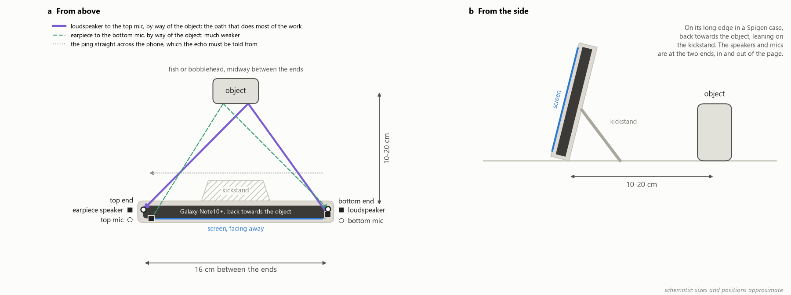
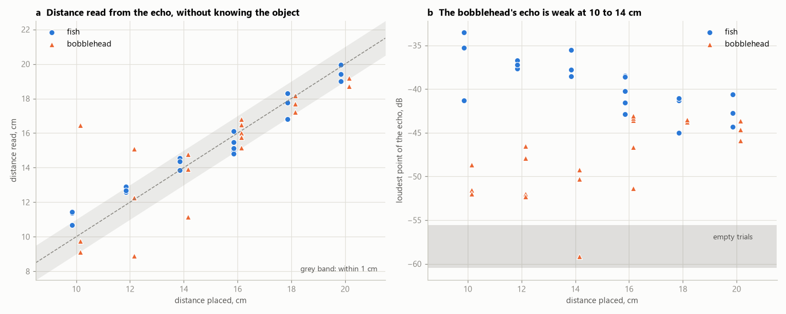
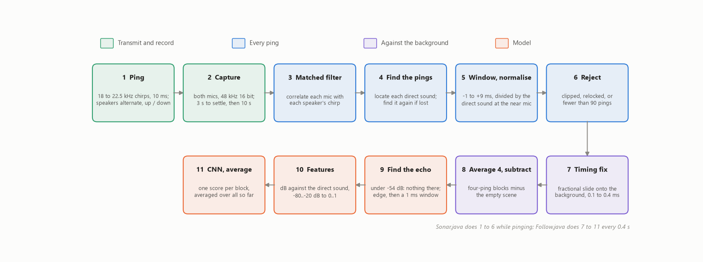

# Phone sonar

A Samsung Galaxy Note10+ used as an active sonar in air. It pings above hearing from its own speakers,
listens with its own microphones, and then, live on the phone, finds what is in front of it, reads how
far away it is, and says which of two objects it is: a 3D-printed fish or a bobblehead.



It is a deliberately small version of the problem a handheld search sonar solves: find a target, range
it and say what it is from its echo, on the device, from data collected in the field. Most of the work
went into finding out what the signal contains, and what could be fooling the model.



*Left: distance read from the echo, each block held out, without knowing the object. Right: how loud
each echo is, against the empty trials.*

## In brief

- **Data.** 42 object recordings and 3 empty trials at measured distances from 10 to 20 cm, in three
  blocks. A fourth block stayed sealed until the method was frozen. 52 earlier recordings, placed by eye
  on other days, are an independent check.
- **Result.** With each block held out, the model names 42 of 42, and distance reads to 1.5 cm rms
  without knowing the object (90% within 2 cm). Trained on the three blocks alone, it names 49 of the 52
  earlier recordings.
- **Sealed test.** Block D: __ of 14 named, __ of 14 within 2 cm.
- **Known weakness.** It names the objects mostly by how strongly they reflect, not by their shape.
  Strength and delay alone name 38 of 42, and making every echo 3 dB louder or quieter drops the model
  to 33.
- **On the phone.** The first guess comes 2.8 s into the pings and updates every 0.4 s, from a 48 KB
  ExecuTorch model and a signal chain in Java that matches the Python on replayed recordings.
- **Scope.** Two hard objects in air, one at a time, on the centre line. Hard objects echo strongly from
  their surface; a body in water echoes weakly and variably, mainly from the air inside it, and nothing
  here measures that ([why](docs/details.md#limits)).

## How it works



1. **Ping and record.** Each end of the phone has a speaker and a mic, 16 cm apart. Each speaker chirps
   from 18 to 22.5 kHz ten times a second, one sweeping up and one down, and both mics record at 48 kHz.
2. **Turn pings into profiles.** Correlating with each chirp turns echoes into peaks against delay. Each
   ping is divided by its own direct sound, which cancels drift.
3. **Isolate the echo.** Pings are lined up with an empty scene to a fraction of a sample, averaged in
   fours, and the empty scene subtracted. Only the two paths crossing the phone are kept.
4. **Find the object.** If the echo's loudest point is under −54 dB, nothing is there. Otherwise its front
   edge, where it first reaches half of its peak power, gives the distance.
5. **Name it.** A 1 ms window from that edge goes in as dB, with nothing removing the level, so strength
   goes in with shape. A 1-D CNN of about 9,000 parameters scores each 0.4 s example, and the answer is
   the average so far.

## Results

Every test holds out whole blocks or sets, because a recording's examples are near-duplicates. Recordings
named correctly, of 42, each block held out:

| Input | Right |
|---|---|
| Follows the echo, strength kept (the model) | 42 |
| Nearest class mean, same input | 41 |
| Fixed window, loudness removed, retrained on these blocks | 39 |
| Strength and delay alone, two numbers | 38 |
| Follows the echo, strength blurred by up to 10 dB in training | 34 |
| Shape statistics | 33 |
| Follows the echo, loudness removed | 31 |

Distance, each block held out, not knowing the object:

| Recordings | rms error | Within 2 cm |
|---|---|---|
| All 42 | 1.46 cm | 90% |
| Fish, 10 to 20 cm | 0.79 cm | 100% |
| Both objects, 16 to 20 cm | 0.76 cm | 100% |
| Bobblehead, 10 to 14 cm | 2.65 cm | 60% |

The first target, ±1 cm on 9 recordings in 10, was missed (74%). The same object placed twice at one mark
reads about 1 cm apart, so the target became ±2 cm. At 2.8 s the model already names the same 42.

**The sealed test.** The tests and pass marks were committed before block D was opened, and a missed mark
stands as the result.

| Test on block D | Pass mark | Result |
|---|---|---|
| Named at 10 s | 12 of 14 | __ |
| Within 2 cm | 13 of 14 | __ |
| Objects found, empty trial rejected | 13 of 14, and rejected | __ |
| Same answer at 2.8 s as at 10 s | 13 of 14 | __ |
| App matches Python | Same answers | __ |

## What could be fooling it

- **Strength instead of shape.** At 10 to 14 cm the fish echoes about 14 dB louder, which does most of the
  naming. At 18 to 20 cm the gap is 2 dB and the model still names all 12, so something else gets through,
  but a different stand angle or a third object could break it.
- **Too little bandwidth to see shape.** The speakers deliver about 19.5 to 22 kHz, which blurs each echo
  over about 5 cm. Both objects are smaller than that: their echoes are no wider than the ping.
- **The bobblehead up close.** Its echo is weak and erratic at 10 to 14 cm, and all four distance errors
  over 2 cm are there. It holds steady from ping to ping, so it isn't moving. The cause is unknown.
- **The spot.** Empty scenes tell the blocks apart, but after subtraction the input doesn't: naming the
  block scores 8 to 15 of 42, where guessing gives 14. A new room is untested.
- **An old empty scene.** Naming holds for about 8 minutes, but an empty mat is taken for an object 6 times
  in 18 at 2.3 minutes.
- **Choosing on the same data.** Many variations were tried on these 42 recordings, so their figures are
  slightly optimistic. Only block D is a clean test, and even 14 of 14 would only show accuracy above 77%.

## Limits

What carries over to a search sonar is the processing, not the physics. Besides hard targets in air
(above): there is no beam, so every direction lands in one echo; a real search has no empty scene to
subtract; and it listens while it transmits, which only a separate speaker and mic allow.

## More

[docs/details.md](docs/details.md) has the first model's tests, both field tests and how to build the app.
[docs/recording.md](docs/recording.md) is how to record a block and use the live mode. `analysis/distance.py`,
`follow.py` and `sealed.py` give the main results, but read the raw recordings, which are not included. The
earlier model reruns from the extracted echoes:

```
pip install -r requirements.txt
cd analysis
python classify.py
```
