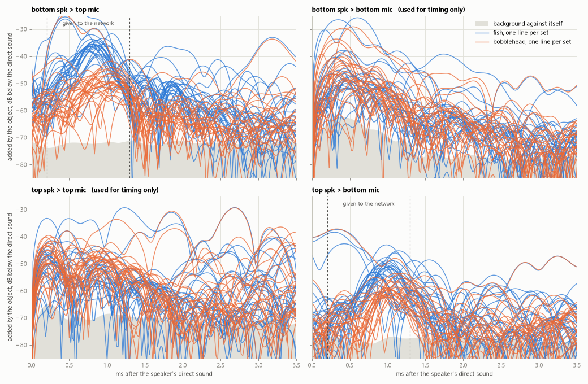

# Phone sonar

A Samsung Galaxy Note10+ used as an active sonar in air. It pings above hearing from its own speakers,
listens with its own microphones, and a small model running on the phone says which of two objects
is standing in front of it: a 3D-printed fish or a bobblehead.

It is a deliberately small version of the problem a handheld search sonar solves: say what a target
is from its echo, on the device, from data collected in the field. Most of the work went into
finding out what the signal contains, and what could be fooling the model.



*What each object added to the empty scene, one line per set, on each speaker-to-mic path. Between
the dashed lines, on the two paths that cross the phone, the fish (blue) and the bobblehead (orange)
separate; that stretch is what the model is given. The grey band is the empty scene against itself:
what is left when nothing has changed.*

## In brief

- **Data.** 15 sets, each an empty scene, the fish and the bobblehead recorded in one spot: 30
  labelled object recordings, 720 examples of 0.4 s. The phone labels its own data, blind.
- **Result.** With each set held out in turn, a small CNN names 29 of the 30 recordings. A
  nearest-class-mean baseline on the same input also names 29. At this sample size the CNN is not
  shown to add anything.
- **Generalisation.** The first model named 16 of 16 in development and 9 of 12 on new sets in the
  field. The cause was found and the input changed. One set has been recorded since: 1 of 2, the
  fish missed.
- **Known weaknesses.** The input still carries the object's distance as well as its shape; it was
  chosen after looking at the later sets; 15 sets is a small sample.
- **On the phone.** A 48 KB ExecuTorch model and the signal chain in Java. Replayed on a PC, the
  app's code gives the same answer as the Python pipeline for all 30 recordings.
- **Scope.** Two hard objects in air, 10 cm away and always present: it classifies, it does not
  detect or locate. Hard objects in air echo strongly from their surface; a body in water echoes
  weakly and variably, mainly from the air inside it, and nothing here measures that
  ([why](docs/details.md#limits)).
- **Next.** Sets recorded at measured distances, which would separate shape from distance.

## Data and evaluation

A Galaxy Note10+ stands on its long edge with the object 10 cm in front. Each end has a speaker and a
mic, 16 cm apart; the model uses the two crossing paths, each speaker to the mic at the far end.
Every test holds out whole sets, because a recording's examples are near-duplicates.

## Results

Recordings named correctly:

| Test | CNN | Nearest class mean |
|---|---|---|
| Each of the 15 sets held out in turn | 29 of 30 | 29 of 30 |
| Trained on the 8 earliest sets, tested on the 7 later | 13 of 14 | 14 of 14 |
| Control: both objects' echoes made equally loud | 28 of 30 | 27 of 30 |

Errors go both ways. A class mean on one path alone names 30 of 30, so these data do not make the
case for the CNN. The input was chosen after seeing the later sets, which flatters the second test.

## What could be fooling it

- **Distance instead of shape.** Neither subtraction nor loudness removal takes out when the echo
  arrived, and that is distance: 1 cm moves it 0.046 ms. Imitating a 3 cm move costs the CNN 3 to 5
  of 30 recordings. Inputs with no timing hold up better, at some cost at 10 cm.
- **Loudness.** The fish echoes about 10 dB louder, but equally loud echoes still separate: the fish's
  is compact and the bobblehead's spread (narrower for the fish in 14 of 15 sets).
- **The room changing** after the empty scene. This broke the first model: something up to half a
  metre away had moved, inside its window. The input now stops at 1.3 ms, as late as an object 10 cm
  away can echo.
- **The phone.** Timing shifts by a fraction of a sample at each start, the level repeats every four
  pings, and the earpiece barely reaches the far mic. Each was measured and handled.

## How it works


Each speaker chirps from 18 to 22.5 kHz ten times a second, one sweeping up and one down; both mics
record at 48 kHz. Correlating with each chirp turns echoes into peaks against delay. Each ping is
divided by its own direct sound, lined up with the empty scene to a fraction of a sample, averaged in
fours, and the empty scene subtracted. A 1-D CNN of about 9,400 parameters scores 0.2 to 1.3 ms of the
two crossing paths, and the app averages over the recording. On the phone it runs in ExecuTorch
(48 KB) with the signal chain in Java, which agrees with the Python pipeline on all 30 recordings.

## Limits

This exercises a search sonar's pipeline, not its physics. Beyond hard targets in air (above): there is
no beam, so every direction lands in one echo; a real search has no empty scene to subtract; and it
listens while it transmits, which only a separate speaker and mic allow.

## More

[docs/details.md](docs/details.md) has every test with its numbers, what the phone does to the data,
the signal chain step by step, the reasoning behind each limit, the next data to collect and how to
build the app. [docs/writeup.md](docs/writeup.md) walks through the figures. To rerun the tests from
the extracted echoes (the raw audio is not included):

```
pip install -r requirements.txt
cd analysis
python classify.py                  # each set held out in turn
python classify.py since 203955     # trained on the 8 earliest sets, tested on the 7 later
```
