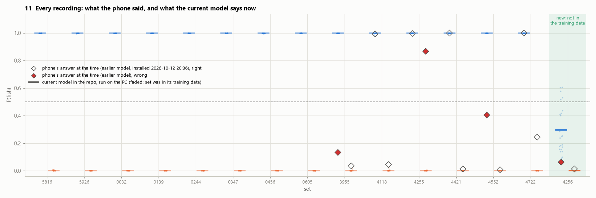
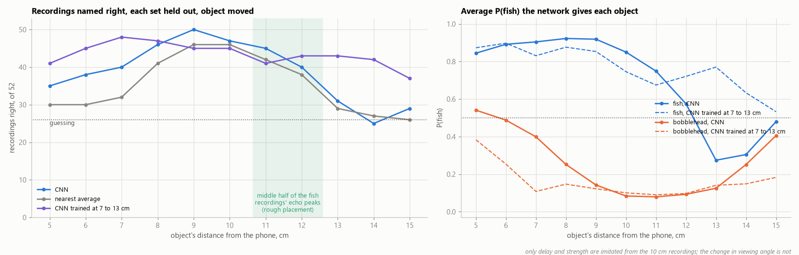
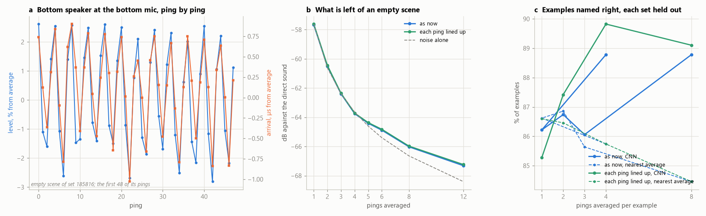
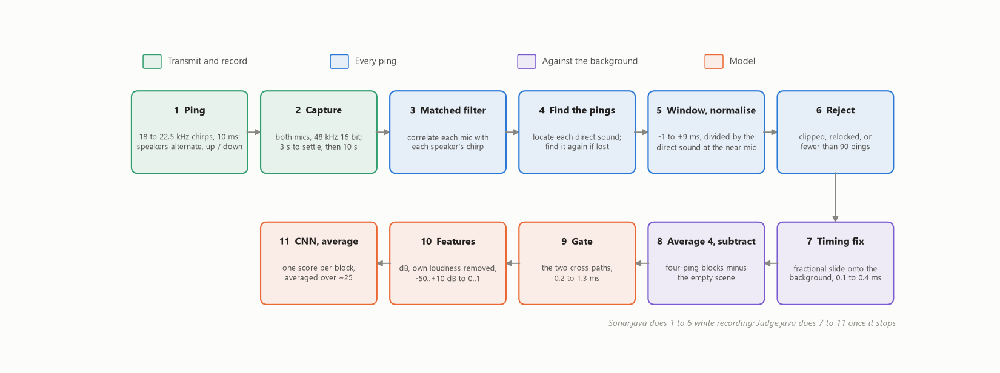
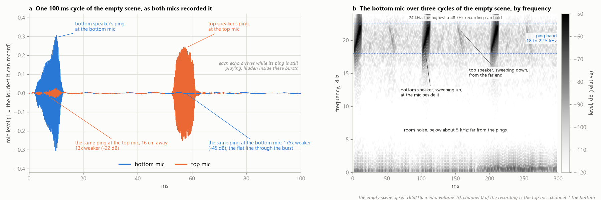
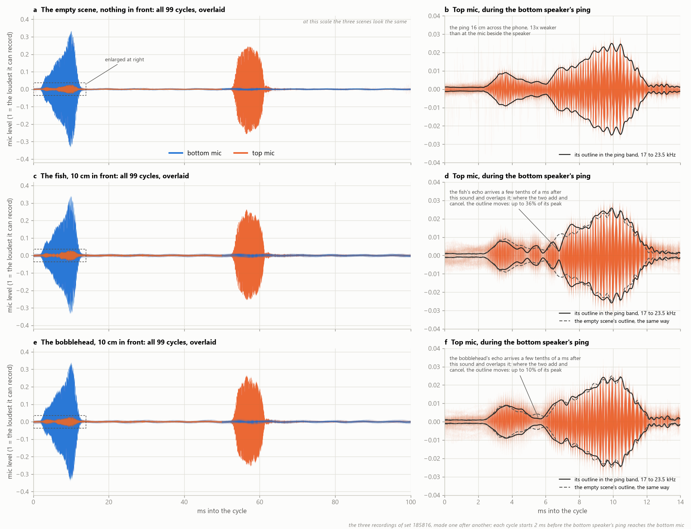
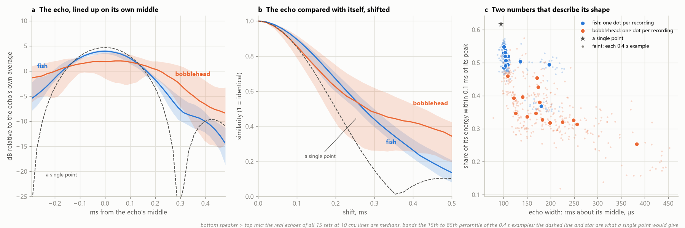

# Phone sonar: the details

*The full account behind the [README](../README.md): every test and its numbers, both field tests, what
the phone does to the data, the signal chain step by step, and the reasoning behind the limits. A walk
through the figures is in [writeup.md](writeup.md).*

## Data and evaluation

A Galaxy Note10+ stands on its long edge with the object 10 cm in front. Each end has a speaker and a
mic, 16 cm apart. The model uses the two crossing paths: each speaker to the mic at the far end.

| Level | Count | What it is |
|---|---|---|
| Set | 26 | One spot (laminate or tile floor, different distances from walls and furniture): the empty scene, then each object, recorded in turn |
| Recording | 78 (52 with an object) | 10 s after 3 s for the hand to get clear; about 100 pings per speaker |
| Example | 1,248 | 4 consecutive pings averaged (0.4 s); about 24 per recording |

Four sessions on three days: 8 sets, then 6, on 12 October 2026; 1 on 13 October; and 12 on 27
October, of which one is left out (see the second field test).

**Labels.** The app records each object without being told which, shows its guess, then asks. Each
trial yields a label and a prediction made before it.

**Quality checks.** Recordings that clip, lose the pings part way, or keep fewer than 90 are
discarded and repeated; the repeat overwrites them, so none are counted here.

**Splits.** Always by whole set: a recording's examples are near-duplicates, and the objects share a
spot with their empty scene, so a random split would leak. Two tests: each set held out in turn, and
trained on the 15 sets up to 13 October, tested on the 11 recorded on 27 October.

## Results

| Test | CNN | Nearest class mean |
|---|---|---|
| Each of the 26 sets held out in turn (52 recordings) | **47 of 52** (89% of examples) | 46 of 52 (86%) |
| Trained on the 15 sets up to 13 October, tested on the 11 from 27 October (22 recordings) | 18 of 22 (79%) | 16 of 22 (73%) |
| Control: both echoes equally loud over the same noise, each set held out | 44 of 52 (81%) | 45 of 52 (82%) |

**Errors by object**, counted separately because in a real search they would not cost the same.
Held out by set, 4 of the CNN's 5 misses are fish named the bobblehead (sets 190605, 195619, 195930
and 200048); the fifth is the bobblehead of 195822, named the fish. The baseline misses 4 fish and 2
bobbleheads. On the phone, the second field test missed 3 fish and 1 bobblehead, and the first missed
2 fish and 1 bobblehead. Missing the fish is the more common error, but 52 recordings are too few for
a rate.

**Simple against complex**, each set held out in turn:

| Model | Input | Recordings right | Examples right |
|---|---|---|---|
| CNN, about 9,400 parameters | Both crossing paths, 2 × 52 values | 47 of 52 | 89% |
| Nearest class mean | Both crossing paths | 46 of 52 | 86% |
| Nearest class mean | Bottom speaker to top mic only, 52 values | 47 of 52 | 89% |
| CNN | Bottom speaker to top mic only | 46 of 52 | 85% |
| Nearest class mean | 8 statistics of the echo's shape, no timing | 48 of 52 | 86% |
| Logistic regression | 8 statistics of the echo's shape, no timing | 46 of 52 | 83% |

With 52 recordings these cannot be ranked; one or two recordings is within chance. The simplest, a
class mean on one path or on eight shape statistics, does as well as the CNN. The CNN runs on the
phone, but these data do not make the case for it over the baseline.

**Caveat.** The input (paths, delays, how loudness is removed) was chosen after seeing the 6 sets
recorded second. The 11 sets of 27 October were recorded after it was chosen, so the second test
above is the fair one.

## The first field test, and what it changed

The first model on the phone used all four paths out to 3.1 ms. Holding out each of the first 8 sets
it named 16 of 16; on the phone, on the next 6 sets, **9 of 12**. The PC reproduced the same three
errors from the same recordings, so the fault was the model's, not the port's.

In two of the three misses both objects had added nearly the same thing to the empty scene, on every
path, peaking 1 to 3 ms out: something up to half a metre away had changed between the recordings,
inside the model's window. The input was cut to the delays the object can produce, 0.2 to 1.3 ms
after the direct sound, and to the two crossing paths. The one set recorded next, on 13 October, went
1 of 2 both with the first model, still on the phone, and with the new input on the PC; both missed
the fish.

On the 11 sets recorded on 27 October, the narrowed input names 18 of 22 with the CNN, against 14 of
22 for the first input. The baseline goes the other way (16 against 18), so the case for the
narrowing rests on the CNN.

## The second field test

From 18 October the phone ran the model trained on the first 15 sets. On 27 October, 12 new sets were
recorded with it, each object guessed before the phone was told what it was.



On the 11 sets kept it named **18 of 22**: 8 of 11 fish and 10 of 11 bobbleheads. The PC, running
the same model on the same recordings, makes the same four mistakes.

The misses are where the echo arrived at an unusual time. In the first 15 sets the fish's echo was
centred 0.63 to 0.97 ms after the direct sound, and the bobblehead's 0.70 to 1.19 ms.

| Set | Recording | Echo centred at | Named |
|---|---|---|---|
| 195930 | Fish | 1.29 ms, later than any before; about what a fish 20 cm out would give | The bobblehead |
| 195822 | Both | 0.61 and 0.63 ms, both early and alike | Each as the other |
| 195619 | Fish | 0.65 ms, at the early edge | The bobblehead |

In 195822 both objects added the same amount in the model's window (−32.7 dB), which fits something
close to the phone changing after the empty scene, or both objects placed closer, more than the
objects themselves. Nothing beyond 1.3 ms changed more than in the earlier sets, so this was not the
half-metre room change of the first field test.

**Set 200754 is left out.** Its recording labelled bobblehead added −30.7 dB in the model's window,
louder than any bobblehead before (at most −49.7 dB) and like a fish. The phone named it the fish at
P(fish) = 0.99, and the recording labelled fish the bobblehead at 0.01. In the app only the first
object is named; the second is filled in as the other, so one mis-tap swaps both labels. Both echoes
also arrived early (0.64 and 0.74 ms), so both objects having stood closer would explain it as well.
Since neither can be confirmed, the set is excluded rather than relabelled, and its files are kept in
`recordings/excluded/`. With it, the phone's score would have been 18 of 24.

## What could be fooling the model

**Distance instead of shape.** Subtracting the empty scene and removing loudness leave the echo's
form, but not when it arrived, and that is the object's distance: each centimetre closer or further
moves the echo 0.046 ms (2.2 samples) on a crossing path. A 2 cm sideways move shifts it only 0.27
samples, as one leg of the path lengthens and the other shortens.



With the recorded echoes moved in delay and strength as if each held-out object stood 3 cm closer or
further, the CNN names 40 and 31 of 52 instead of 47; the baseline 32 and 29 instead of 46. By 14 cm
the CNN is at chance. Trained on copies moved between 7 and 13 cm, it holds 41 to 48 from 5 to 14 cm.
At the same nominal 10 cm, the fish's echo is centred 0.83 ms after the direct sound and the
bobblehead's 0.96 ms. That may be shape (parts of the bobblehead on longer paths) or where each was
put down; the input can use both, and these data cannot tell them apart. The second field test's
misses are this weakness met for real.

Inputs without timing were tested as an alternative (figure 3; [writeup.md](writeup.md)). Moved from
5 to 15 cm, the current input names 25 to 50 of 52; the echo's autocorrelation 42 to 47, with 47 at
10 cm; eight shape statistics 44 to 49 with logistic regression (46 at 10 cm) and 42 to 48 with a class
mean (48 at 10 cm). Moving recorded echoes does not change the angle the object is seen from, so this
is the least a real move would do.

**Loudness.** The fish's echo is about 10 dB stronger than the bobblehead's, so the model could be
reading level. Each path's loudness is removed, and in the control, with both echoes at the same
level over the same real noise, the CNN still names 44 of 52. What is left is how the energy spreads
over delay: the fish's echo is compact, the bobblehead's spread (median width 105 µs against 143 µs
on the louder crossing path), and the fish's is the narrower in 23 of the 26 sets.

**The room changing** between the empty scene and the object: the cause of the first field failures.
The input now stops at the latest delay an object 10 cm away can produce.

**Near-duplicate examples.** A recording's 24 or so examples share one placement, so every test
holds out whole sets.

**The phone itself:** below.

## What the phone does to the data

These properties of this phone had to be measured before any two recordings could be compared.

| Effect | Size | What is done about it |
|---|---|---|
| Each time audio starts, each speaker's sound lands a fraction of a sample early or late, and stays so | Up to about a sample between recordings (−1.2 to +0.9 found); left alone, larger than the echo | Fitted per recording 0.1 to 0.4 ms after the direct sound, before any echo, and removed with a phase ramp in the frequency domain |
| Level and timing repeat every four pings | Level 1.9 to 2.0% rms (4.7 to 5.0% peak to trough); timing about 1.2 µs | Dividing each ping by its direct sound leaves less than the noise (below) |
| The direct sound has two nearly equal peaks a sample apart | — | The earliest strong one is always taken, so recordings agree |
| The earpiece is quiet at the far mic | −45 dB below its own end; the loudspeaker −22 dB | Its path alone names 38 or 43 of 52 recordings, the loudspeaker's 46 or 47: in effect one transmitter and one receiver |
| Only one recording setting gives two different mics | 24 combinations of source, channel mask and input tried; the mic by the cameras is unreachable | `MIC` source, stereo mask: top and bottom mics |
| The mic stops rising in step with the ping above about a quarter of its range | Doubling the drive from 0.1 to 0.2 gives 0.41 of full scale, not 0.5; a drive of 0.4 clips | Pings at a quarter of the range (media volume 10 or 11); the louder top speaker driven at 0.7; clipped recordings discarded |
| 48 kHz sampling holds nothing above 24 kHz | The 18 to 22.5 kHz band resolves range to about 3.8 cm | Sets the resolution; rules out a beam (Limits) |



**The four-ping pattern** (`analysis/four_ping.py`). Each speaker's level steps through four values,
and its arrival moves with it (correlation 0.96 for the bottom speaker, −0.92 for the top), as if the
audio output placed each ping a slightly different fraction of a sample late on a four-ping cycle.
Dividing by the direct sound removes the level but not the timing, yet nothing measurable survives:
on the empty scenes, what is left in the model's window falls with the pings averaged exactly as
noise would (−57.7 dB for one, −63.7 dB for four, against −57.6 and −63.6), and three or five pings,
which do not span the pattern, leave no more than four. Held out, one to eight pings per example do
about equally well (CNN 46 to 48 of 52). Averaging four is not needed for the pattern; it lowers the
noise, though at this sample size accuracy barely depends on it.

## How it works



1. **Ping.** 10 ms linear chirps, 18 to 22.5 kHz, with a 2 ms raised-cosine fade at each end. The
   speakers alternate, one sweeping up and one down so they can be told apart, each ten times a second.
2. **Record.** Both mics at 48 kHz, 16 bit: 10 s, after 3 s for the hand to get clear.
3. **Matched filter.** Correlate each mic with each speaker's chirp (template matching): each 10 ms
   sweep becomes a peak about 0.2 ms wide, giving echo strength against delay for every ping.
4. **Find the pings.** Lock on to each speaker's direct sound at the mic beside it; if lost, find it
   again and count it.
5. **Window and reference.** Keep 1 ms before to 9 ms after the direct sound, and divide each ping by
   it (a complex division, so drift in gain and phase cancels).
6. **Reject** recordings that clipped, lost the pings, or kept fewer than 90.
7. **Timing fix.** Slide each speaker's pings by the fraction of a sample that lines them up with the
   empty scene's.
8. **Average and subtract.** Average the pings in fours and coherently subtract the empty scene
   recorded just before, leaving what the object added.
9. **Gate.** The two crossing paths, 0.2 to 1.3 ms after the direct sound: as late as an object 10 cm
   away can echo.
10. **Features.** Decibels along delay, each path's own loudness removed, −50 to +10 dB scaled onto 0
    to 1: a 2 × 52 array per example.
11. **Classify and vote.** The model scores each example; the app averages over the recording.



*Figure 1. The empty scene. Each speaker is loudest at the mic beside it; at the far mic its ping is
13 times weaker from the loudspeaker and 175 times from the earpiece. The echoes arrive while the
ping still plays, hidden inside the bursts.*



*Figure 2. All 99 cycles of one set's three recordings, overlaid. At full scale they look the same.
At the far mic, where the crossing ping is weak, the object's echo overlaps it and reshapes the
burst: by up to 36% of its peak with the fish and 10% with the bobblehead, against 4.7% from ping to
ping with nothing in front.*



*Figure 3. Three descriptions of the echo without its timing, used in the distance test. The dashed
line and star are a single point, the sharpest echo this sonar can produce: the fish's echo is close
to it, the bobblehead's spread.*

A longer walk through these figures is in [writeup.md](writeup.md); rough figures for every step,
simulated and real, are in `docs/steps/`.

**The model.** A 1-D CNN over delay with the two paths as channels: three blocks of convolution,
batch norm, ReLU and max-pool (16, 32 and 64 channels; kernels 7, 5 and 3), a maximum over delay, and
a linear layer to two classes. About 9,400 parameters; it trains in seconds on a laptop CPU. The
baseline is the nearest class mean on the same input.

## On the phone

The PyTorch model is exported with `torch.export` to ExecuTorch (XNNPACK backend, a 48 KB program)
and runs in a native Android app, with the signal chain reimplemented in Java. Three checks keep
phone and PC in step:

- ExecuTorch against PyTorch on the PC, over all 1,248 training examples: the largest difference in
  probability is 2e-6.
- At every start the app re-runs one stored example per recording against PyTorch's answer and will
  not guess if they disagree.
- Replayed on the PC through the app's Java code (`app/sim/check.ps1`), all 52 recordings get the
  same answer as the Python pipeline, within 0.07 in probability, at 0.3 s each including playback.

The phone ran the 15-set model in the second field test. This repository holds the model retrained on
all 26 sets.

## Limits

This exercises a search sonar's pipeline, not its physics. The differences, most important first:

**The targets are acoustically hard; a body in water is not.** Acoustic impedance, density times
sound speed, is about 410 rayl for air, 1.5 million for water, and millions for dense solids. In air
any dense solid reflects about 99.9% of the sound energy at its surface, whatever it is made of, so
both printed objects are near-perfect mirrors and the echo carries their outline and nothing else.
In water, soft tissue (about 1.6 million rayl) is nearly matched to its surroundings and reflects
well under 1% at the skin. A body returns sound mainly from the air in its lungs and from bone, a
real fish mainly from its swim bladder. Those echoes are weaker and far more variable: they depend on
how much gas there is (depth compresses it, and drowning can replace it with water) and on what is
inside the target, not on its shape. Nothing here measures how separable such targets are.

**There is no beam.** Beam width is set by the aperture in wavelengths. At 18 to 22.5 kHz the
wavelength in air is 15 to 19 mm, larger than the phone's speaker and mic openings, so each sends
and receives in nearly all directions; a 10 degree beam would need an aperture about 10 cm across.
The phone cannot go higher, because 48 kHz sampling stops at 24 kHz. A search sonar typically works
at hundreds of kilohertz, where the wavelength in water is a few millimetres and a transducer a few
centimetres across is many wavelengths wide. Its beam gives bearing, keeps everything outside it out
of the echo, and concentrates the energy; one transducer, swept, is enough.

Without a beam, everything in range in every direction lands in one echo: floor, walls, whoever is
nearby. The phone substitutes three things: a transmitter and receiver 16 cm apart, subtraction of
the empty scene, and ignoring delays the object cannot produce.

**A search has no empty scene to subtract.** Subtraction needs the same scene, unchanged, without the
target. Two of the three wrong guesses in the first field test appear to come from something up to
half a metre away changing between two recordings on an indoor floor. Open water is never still, and
there is no recording of it from before the person went in.

**It listens while it transmits.** The 10 ms chirp is 3.4 m long in air, against about 25 cm from
speaker to object to mic, so the echo arrives while the ping is still being sent. That works only
because speaker and mic are separate, at the price of the direct sound reaching the mic stronger than
the echo. A single transducer cannot listen while it transmits: it sends short pings and is blind
close in.

**Scale and scope.** 10 cm, not tens of metres; one stationary phone on a stand, not a moving
handheld device; two objects at one distance and position. It classifies an object known to be
there; it does not detect or locate. And 26 sets is a small sample, 11 of them recorded after the
input was chosen.

## Next data to collect

Each answers a question the current data cannot:

- **Sets at measured distances**, such as 7, 10 and 13 cm from a marked spot: does the model read
  shape or distance, and how much of the 0.13 ms between the objects' echoes is shape? The second
  field test's misses make this the first priority.
- **An input without timing, tested in the field:** the shape statistics hold up across imitated
  moves; real moves also change the angle the object is seen from.
- **The empty scene twice, with something moved half a metre away in between:** how large is what a
  changed room leaves, next to a real echo? That bounds what subtraction can be trusted with.
- **New rooms, floors and days:** the 26 sets come from four indoor sessions on three days. Do the
  results hold beyond them?
- **More objects, including two of similar size and different shape:** is the separation shape, or
  only that one object is compact and loud?
- **The phone held in the hand:** movement breaks both the per-recording timing fix and the
  subtraction of the empty scene.

## Reproduce

The raw recordings are audio of the room and are not included. `echoes.npz` holds what the signal
chain extracts from them, enough to rerun everything from the model input on:

```
pip install -r requirements.txt
cd analysis
python classify.py                  # each set held out in turn; saves the model trained on every set
python classify.py since 195308     # trained on the 15 sets up to 13 October, tested on the 11 from 27 October
python classify.py grid             # every window, path and loudness choice that was compared (slow)
```

`sets.py`, `control.py`, `placement.py`, `shape.py`, `four_ping.py`, `figures.py` and
`steps_real.py` need the raw recordings in `recordings/sets`; `export.py` needs the `executorch`
package in its own environment (see its docstring). `steps_real.py` compares the phone's answers with
whichever model is saved, and marks the sets that model was not trained on.

The app builds without Gradle or Android Studio, given JDK 17 and the Android SDK (platform 34,
build-tools 34.0.0) in `%LOCALAPPDATA%\Android` as `jdk-17` and `Sdk`:

```
powershell -ExecutionPolicy Bypass -File app\get-libs.ps1    # ExecuTorch 1.5.1 from Maven Central
powershell -ExecutionPolicy Bypass -File app\build.ps1
powershell -ExecutionPolicy Bypass -File app\sim\check.ps1   # the app's own code on the PC, against the recordings
```

## Repository

| | |
|---|---|
| `analysis/scene.py` | A recording to echo profiles: matched filter, reference, timing fix, averaging |
| `analysis/sets.py` | Sets of recordings to echoes; draws the figure at the top of the README |
| `analysis/classify.py`, `model.py` | Model input, the CNN and the baseline, training, held-out tests |
| `analysis/control.py` | Control: both objects equalised in loudness and noise |
| `analysis/placement.py` | The object moved from 5 to 15 cm, imitated on the recordings |
| `analysis/shape.py` | Inputs without timing: aligned echo, autocorrelation, shape statistics |
| `analysis/four_ping.py` | The four-ping pattern, what it leaves, and pings per example |
| `analysis/figures.py` | Figures 1 to 3 |
| `analysis/steps.py`, `steps_real.py` | A rough figure for every step, simulated and real (`docs/steps/`), and the phone's answers against the saved model |
| `analysis/export.py` | PyTorch to ExecuTorch, with the examples the app checks itself against |
| `analysis/echoes.npz` | The echoes of all 26 sets |
| `app/src/` | The Android app: `Sonar` (audio), `Judge` (signal chain), `Net` (ExecuTorch), `MainActivity` (collection flow) |
| `app/sim/` | PC checks of the app's code |
| `docs/` | Figures, and a longer walk through them (`writeup.md`) |

## Glossary

| | |
|---|---|
| Ping | One chirp from one speaker: a 10 ms tone sweeping between 18 and 22.5 kHz |
| Path | One speaker to one mic; the two crossing paths go from a speaker at one end to the mic at the other |
| Direct sound | The ping arriving straight from the speaker, before any echo; every ping is measured against it |
| Empty scene | The recording made with nothing in front, just before the objects; subtracted from both |
| Set | An empty scene and the two objects, recorded in one spot |
| Example | The average of four consecutive pings: 0.4 s of one recording |
| Held out | Left out of training and used only for testing; here always a whole set at a time |
| Nearest class mean | The baseline: an example is called whichever object's average example it is closer to |
| dB | Ten times the log of a power ratio: −20 dB is a tenth of the amplitude, −40 dB a hundredth |
